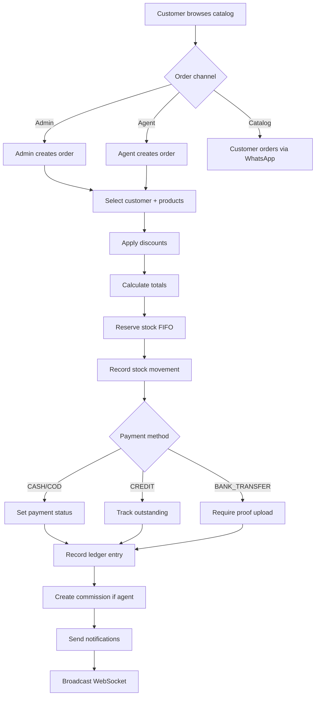
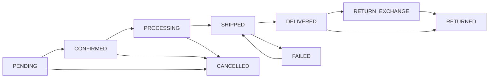
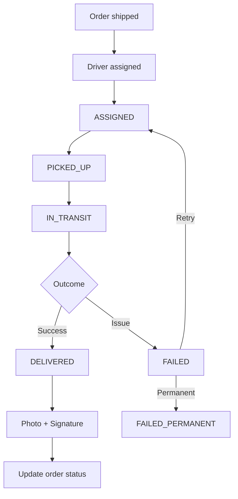
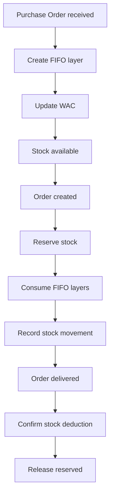
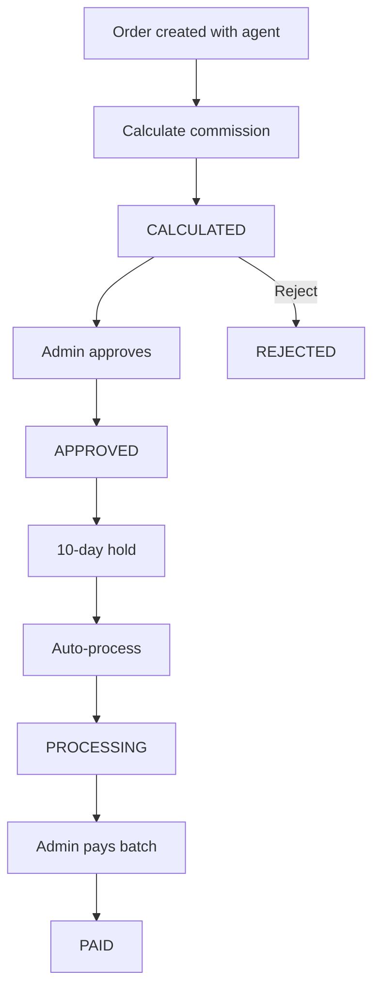
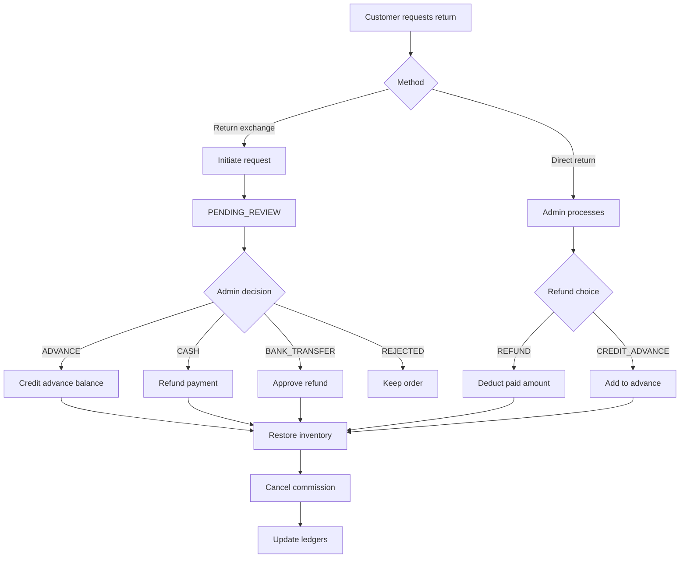
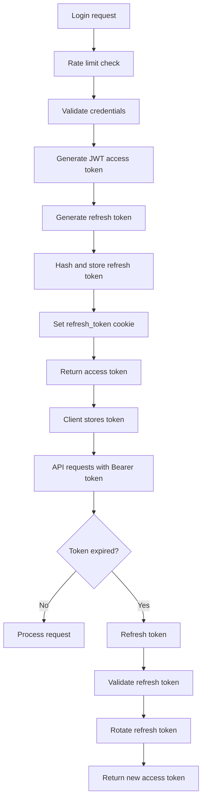

# PROJECT SCOPE ANALYSIS — Ebee Ecosystem

> **Document Type:** Software Architecture & Project Scope Report
> **Generated:** August 2025
> **Purpose:** Comprehensive documentation of all implemented functionality for project valuation and effort estimation

---

## 1. Executive Summary

### Purpose

Ebee is a **full-stack Sri Lankan commerce platform** comprising a Spring Boot monolith backend, an admin web application, a sales agent portal, a customer-facing storefront, a driver mobile application, and a marketing landing page. The platform handles the complete business lifecycle: product catalog management, order processing, inventory tracking with FIFO/WAC costing, delivery logistics with real-time GPS tracking, agent commission management, supplier procurement, financial accounting, and multi-channel communications.

### Business Domain

- **Industry:** Retail / E-commerce / Distribution
- **Geography:** Sri Lanka (8 districts)
- **Currency:** LKR (Sri Lankan Rupee)
- **Business Model:** Agent-driven sales + direct orders + customer catalog
- **User Roles:** Super Admin, Admin, Agent, Driver

### High-Level Architecture

```
┌─────────────────────────────────────────────────────────────────────┐
│                        Ebee Ecosystem                               │
├──────────────┬──────────────┬──────────────┬────────────────────────┤
│  bee-store   │  bee-portal  │  Ebee Admin  │    ebee-landing        │
│  (Next.js)   │  (React)     │  (React)     │    (React SPA)         │
│  Customers   │  Agents      │  Admins      │    Marketing           │
├──────────────┴──────────────┴──────────────┴────────────────────────┤
│                          REST API + WebSocket                       │
├─────────────────────────────────────────────────────────────────────┤
│                    Ebee_Core (Spring Boot)                          │
│  PostgreSQL · Redis · MinIO · Firebase · WhatsApp · Email · SMS    │
├─────────────────────────────────────────────────────────────────────┤
│                    bee-driver (React Native / Expo)                 │
│                    Native Android GPS + WebSocket                   │
└─────────────────────────────────────────────────────────────────────┘
```

### Repository Relationships

| Repository | Communicates With | Protocol |
|---|---|---|
| Ebee_Core | All frontends | REST API, STOMP WebSocket, Raw WebSocket |
| Ebee (Admin) | Ebee_Core | REST + STOMP (`/ws`, `/topic/*`) |
| bee-portal (Agent) | Ebee_Core | REST API |
| bee-store (Catalog) | Ebee_Core | REST API (public endpoints) |
| bee-driver | Ebee_Core | REST + STOMP + Raw WebSocket (`/raw-ws/driver`) |
| ebee-landing | None (static) | N/A |
| bee-Catalog | Ebee_Core | REST API (public endpoints) |

---

## 2. Repository Overview

### 2.1 Ebee_Core — Backend Monolith

| Attribute | Value |
|---|---|
| **Purpose** | Central API server and business logic engine |
| **Framework** | Spring Boot 3.4.x |
| **Language** | Java 21 |
| **Build** | Maven (`./mvnw`) |
| **Database** | PostgreSQL (Flyway-managed, 120+ migrations) |
| **Cache** | Redis (Lettuce) |
| **Object Storage** | MinIO (S3-compatible) |
| **Security** | Spring Security + JWT (HS256) |
| **Notifications** | Gmail SMTP, Dialog SMS, Firebase Cloud Messaging, WhatsApp Business API |
| **Scheduling** | Spring `@Scheduled` + ShedLock (JDBC) |
| **WebSocket** | STOMP over SockJS + Raw WebSocket |
| **Server Port** | 8085 |

**Major Modules (39 controllers, 200+ endpoints):**
- Authentication & Authorization (JWT, refresh tokens, OTP, IP whitelist)
- User Management (CRUD, roles, profiles)
- Agent Management (documents, commissions, applications)
- Customer Management (dues, advances, credit limits, ledger)
- Product & Category Management (images, specifications, discounts)
- Order Management (create, cancel, return, exchange, payments)
- Inventory Management (FIFO layers, WAC, stock movements, reservations)
- Delivery & Driver Management (status workflow, assignment)
- Trip Management (route planning, order assignment)
- Commission Management (configs, calculation, lifecycle, batch payout)
- Purchase Order & Supplier Management (procurement, payments, returns)
- Expense Management (submission, approval workflow)
- Accounting (customer/supplier/agent ledgers, fiscal periods, trial balance, aging)
- Reporting (28 report endpoints across 11 domains)
- Messaging & Notifications (multi-channel: email, SMS, push, WhatsApp)
- Audit Logging & Database Backup
- Combo/Bundle Management (product bundles with rules)
- Lead Management (capture, conversion)
- Reminder System (scheduled alerts with email/SMS)
- WhatsApp Webhook Integration

### 2.2 Ebee (Admin) — Web Application

| Attribute | Value |
|---|---|
| **Purpose** | Full-featured admin dashboard for business operations |
| **Framework** | React 18 + TypeScript + Vite |
| **Styling** | Tailwind CSS + shadcn/ui |
| **State** | Zustand (auth) + React Context |
| **Charts** | Recharts |
| **Maps** | MapLibre GL JS |
| **WebSocket** | STOMP over SockJS |

**Major Pages (48 routes):**
- Dashboard (31 parallel API calls, KPIs, charts, tables)
- Orders (CRUD, status management, real-time WebSocket updates)
- Order Detail (tabs: general, agent, payments, delivery, returns, exchanges)
- Delivery Board (Kanban with drag-and-drop, real-time updates)
- Trip Management (create, assign orders, start/complete/cancel)
- Live Driver Tracking (MapLibre GL map, 3D truck markers, real-time GPS)
- Product Management (CRUD, image upload, stock adjustment, FIFO layers)
- Customer Management (CRUD, dues, advances, credit limits, ledger, payments)
- Agent Management (CRUD, documents, commission rates)
- Commission Management (calculate, approve, pay batch)
- Supplier & Purchase Order Management
- Accounting (periods, trial balance, aging reports)
- Expense Management
- Calendar & Reminders
- Messaging (broadcast to agents/customers)
- Reports (28 report types across 11 domains)
- Database Backup (OTP-verified)
- Settings (profile, security)

### 2.3 bee-portal — Agent Portal

| Attribute | Value |
|---|---|
| **Purpose** | Sales agent self-service portal |
| **Framework** | React 19 + TypeScript + Vite |
| **Styling** | Tailwind CSS v4 + shadcn/ui |
| **State** | Zustand (auth) |

**Pages (12 routes):**
- Login / Forgot Password / OTP / Reset Password / Setup Password
- Dashboard (agent stats, leaderboard widget)
- Orders (list, create new order)
- Commissions (history, earnings)
- Profile (personal info, commission details)
- Products (browse, search, category filter)
- Leaderboard (agent rankings)
- Admin User Management (SUPER_ADMIN only)

### 2.4 bee-store — Customer Storefront

| Attribute | Value |
|---|---|
| **Purpose** | Customer-facing product catalog and ordering |
| **Framework** | Next.js 16 (App Router, SSR) |
| **Language** | TypeScript |
| **Styling** | Tailwind CSS v4 |

**Pages (9 routes):**
- Homepage (hero carousel, trending products, promo banners)
- Shop (product listing with filters)
- Categories (category browsing)
- Product Detail (gallery, specs, pricing)
- Search (product search)
- About, Contact, FAQ, How to Order

**Ordering:** WhatsApp-based (no cart/checkout — orders go through WhatsApp)

### 2.5 bee-Catalog — Product Showcase

| Attribute | Value |
|---|---|
| **Purpose** | Read-only product catalog for customers |
| **Framework** | React 18 + Vite |
| **Language** | JavaScript (JSX) |
| **Styling** | Tailwind CSS v4 |

**Pages (3 routes):**
- Product listing (infinite scroll, search, category, price range, sort)
- Product detail (image carousel, specs, pricing)
- About page

**Note:** No cart, no checkout, no authentication. Purely a product browser.

### 2.6 bee-driver — Driver Mobile Application

| Attribute | Value |
|---|---|
| **Purpose** | Delivery driver mobile app |
| **Framework** | React Native / Expo SDK 54 |
| **Language** | TypeScript |
| **Target** | Android (primary), iOS (supported) |
| **Package ID** | `com.ebee.driver` |

**Screens (17 screens):**
- Login / Set Password / Forgot Password
- Dashboard (active deliveries, quick actions)
- Deliveries List (paginated, status filters)
- Delivery Detail (status timeline, actions)
- Delivery Complete (4-step wizard: photo, signature, notes, submit)
- Alerts (push notifications, mark read)
- Profile (edit, photo upload, change password)
- Expenses (list, create with receipt)
- Stats (deliveries, earnings, completion rate)
- Live Location (GPS coordinates, address)

**GPS Tracking:** Native Android foreground service with triple-redundancy (foreground service + WorkManager + AlarmManager), raw WebSocket communication, offline location queue (500 locations).

### 2.7 ebee-landing — Marketing Site

| Attribute | Value |
|---|---|
| **Purpose** | Brand marketing and lead generation |
| **Framework** | React 19 + TypeScript + Vite |
| **Styling** | Tailwind CSS v4 + shadcn/ui |

**Sections (15):** Hero, Stats, Featured Products, How It Works, Why Choose, Team, Testimonials, Capabilities, Business Features, Trust, FAQ, Newsletter, CTA, Footer, Floating Buzz animation.

---

## 3. Complete Feature Inventory

### 3.1 Authentication & Authorization

| Feature | Repository | Description |
|---|---|---|
| Email/Password Login | Ebee_Core, Admin, Agent, Driver | JWT access token (24h) + refresh token (7 days) |
| Token Refresh | Ebee_Core, Admin, Agent, Driver | Automatic rotation with refresh token |
| Password Reset (OTP) | Ebee_Core, Admin, Agent, Driver | Email OTP → reset token (5min expiry) → new password |
| Forced Password Change | Ebee_Core, Agent, Driver | `mustChangePassword` flag on new users |
| Role-Based Access | Ebee_Core, Admin | SUPER_ADMIN > ADMIN > AGENT > DRIVER |
| IP Whitelist | Ebee_Core, Admin | Per-user IP restrictions for super admin |
| Rate Limiting | Ebee_Core | Redis-based: login (10/15min), generic (30/15min), IP (200/min) |
| JWT Security | Ebee_Core | HS256, HttpOnly refresh cookie, separate reset signing key |
| HTTP Security Headers | Ebee_Core | XSS protection, HSTS, CSP, Referrer-Policy |
| CORS | Ebee_Core | Configurable allowed origins |

### 3.2 User Management

| Feature | Repository | Description |
|---|---|---|
| User CRUD | Ebee_Core, Admin | Create, read, update, delete users |
| Role Assignment | Ebee_Core, Admin | SUPER_ADMIN, ADMIN, AGENT, DRIVER |
| User Status | Ebee_Core, Admin | ACTIVE, INACTIVE, SUSPENDED, LOCKED |
| Profile Management | Ebee_Core, Admin, Agent, Driver | Photo upload/delete, personal info |
| Login Alerts | Ebee_Core, Admin, Agent | Toggleable login notification emails |
| Password Policy | Ebee_Core, Admin, Agent, Driver | Uppercase, lowercase, digit, special char, 8+ chars |

### 3.3 Agent Management

| Feature | Repository | Description |
|---|---|---|
| Agent CRUD | Ebee_Core, Admin | Create, update, delete agents |
| Document Upload | Ebee_Core, Admin | NIC document, bank passbook |
| Commission Rate | Ebee_Core, Admin | Per-agent custom commission rate |
| Agent Code Generation | Ebee_Core | Sequential code with district prefix |
| Agent Applications | Ebee_Core, Admin, Landing | Public application form, admin review |
| Password Reset | Ebee_Core, Admin | Admin-initiated password reset |

### 3.4 Customer Management

| Feature | Repository | Description |
|---|---|---|
| Customer CRUD | Ebee_Core, Admin, Agent | Create, update, search customers |
| Customer Code | Ebee_Core | Auto-generated with district prefix |
| Book Number | Ebee_Core, Admin | Optional book number tracking |
| Credit Limit | Ebee_Core, Admin | Configurable credit limit (enforced at order creation) |
| Outstanding Balance | Ebee_Core, Admin, Agent | Real-time tracking from ledger |
| Advance Balance | Ebee_Core, Admin | Prepaid credit from cancellations/returns |
| Customer Ledger | Ebee_Core, Admin | Immutable double-entry ledger (debit/credit) |
| Bulk Payment | Ebee_Core, Admin | FIFO payment across unpaid orders |
| Advance History | Ebee_Core, Admin | Paginated advance transaction history |
| Manual Adjustments | Ebee_Core, Admin | Outstanding increase + advance adjustment |
| WebSocket Updates | Ebee_Core, Admin | Real-time dues changes on `/topic/customer-dues` |

### 3.5 Product Management

| Feature | Repository | Description |
|---|---|---|
| Product CRUD | Ebee_Core, Admin | Create, update, delete products |
| Image Management | Ebee_Core, Admin | Multi-image upload, WebP conversion, primary image |
| Discount System | Ebee_Core, Admin, Agent, Catalog | PERCENTAGE/FIXED discounts with max discount cap |
| Specifications | Ebee_Core, Admin, Catalog | Key-value specification pairs |
| Brand & Tags | Ebee_Core, Admin, Catalog | Brand field, comma-separated tags |
| Category Management | Ebee_Core, Admin, Catalog, Store | CRUD for categories |
| Featured Products | Ebee_Core, Admin, Catalog, Store | Featured flag for homepage |
| Product Search | Ebee_Core, Admin, Agent, Catalog, Store | Basic, advanced, filtered search |
| Product Label PDF | Ebee_Core, Admin | Downloadable product labels |
| Active/Inactive | Ebee_Core, Admin | Product activation/deactivation |

### 3.6 Inventory Management

| Feature | Repository | Description |
|---|---|---|
| Stock Tracking | Ebee_Core, Admin | Real-time quantity, available, reserved |
| FIFO Cost Layers | Ebee_Core, Admin | Per-receipt cost layers with FIFO consumption |
| Weighted Average Cost | Ebee_Core, Admin | WAC calculated from remaining layers |
| Stock Adjustments | Ebee_Core, Admin | IN, OUT, ADJUSTMENT, RETURN, DAMAGE, RESERVE, RELEASE |
| Stock Reservations | Ebee_Core, Admin | Reserve/release for pending orders |
| Low Stock Alerts | Ebee_Core, Admin | Configurable reorder level alerts |
| Stock History | Ebee_Core, Admin | Full movement history with before/after quantities |
| Optimistic Locking | Ebee_Core | Version-based concurrency control |

### 3.7 Order Management

| Feature | Repository | Description |
|---|---|---|
| Order Creation | Ebee_Core, Admin, Agent | With agent or direct, multiple payment methods |
| Order Status Workflow | Ebee_Core, Admin, Agent | PENDING → CONFIRMED → PROCESSING → SHIPPED → DELIVERED |
| Order Cancellation | Ebee_Core, Admin | Stock release, commission rollback, financial adjustment |
| Item-Level Returns | Ebee_Core, Admin | Return specific items/quantities, partial returns |
| Return Exchange | Ebee_Core, Admin | Initiate → Review (ADVANCE/CASH/BANK_TRANSFER/REJECTED) |
| Payment Recording | Ebee_Core, Admin, Agent | Per-order and bulk customer payments |
| Advance Usage | Ebee_Core, Admin | Apply advance balance to orders |
| Per-Order Discounts | Ebee_Core, Admin | Admin discounts capped at product max |
| Order PDFs | Ebee_Core, Admin, Agent | Invoice, receipt, shipping label |
| Combo/Bundle Orders | Ebee_Core, Admin, Agent | Product bundles with rules (free product, discount) |
| Real-time Updates | Ebee_Core, Admin | WebSocket on `/topic/orders` |

### 3.8 Shopping Cart & Checkout

| Feature | Repository | Description |
|---|---|---|
| Cart | None | No cart implementation exists |
| Checkout | None | Orders created directly (not through cart) |
| WhatsApp Ordering | bee-store | Orders placed via WhatsApp link |

### 3.9 Delivery Management

| Feature | Repository | Description |
|---|---|---|
| Delivery Kanban | Admin | 6-column board: Assigned, Picked Up, In Transit, Delivered, Failed, Failed Permanent |
| Drag-and-Drop | Admin | Move delivery cards between columns |
| Driver Assignment | Ebee_Core, Admin | Assign available drivers to deliveries |
| Status Transitions | Ebee_Core, Admin, Driver | ASSIGNED → PICKED_UP → IN_TRANSIT → DELIVERED/FAILED |
| Failure Handling | Ebee_Core, Admin, Driver | Report issue with reason, retry, permanent fail |
| Delivery Proof | Ebee_Core, Admin, Driver | Photo + signature capture |
| Driver Notes | Ebee_Core, Admin, Driver | Text notes on delivery |
| Delivery Filtering | Admin | By district, trip, unassigned, search |
| Real-time Updates | Admin | WebSocket on `/topic/deliveries` |

### 3.10 Driver Management

| Feature | Repository | Description |
|---|---|---|
| Driver CRUD | Ebee_Core, Admin | Create, update, list drivers |
| Availability Status | Ebee_Core, Admin, Driver | AVAILABLE, OFFLINE, BUSY |
| FCM Token Registration | Ebee_Core, Driver | Push notification device tokens |
| Driver Dashboard | Ebee_Core, Driver | Active deliveries, completed today, recent |
| Driver Stats | Ebee_Core, Driver | Deliveries, earnings, completion rate |
| Profile Photo | Ebee_Core, Driver | Upload profile photo |

### 3.11 Trip Management

| Feature | Repository | Description |
|---|---|---|
| Trip CRUD | Ebee_Core, Admin | Create, update, delete trips |
| Trip Lifecycle | Ebee_Core, Admin, Driver | PLANNED → IN_PROGRESS → COMPLETED/CANCELLED |
| Order Assignment | Ebee_Core, Admin, Driver | Assign/unassign orders to trips |
| Map Markers | Ebee_Core, Admin, Driver | Geocoded order locations for trip |
| Mileage Tracking | Ebee_Core, Driver | Update trip mileage |
| Trip Expenses | Ebee_Core, Driver | Create expenses linked to trips |

### 3.12 Commission Management

| Feature | Repository | Description |
|---|---|---|
| Commission Configs | Ebee_Core, Admin | DEFAULT, CUSTOM, TIERED configurations |
| Auto-Calculation | Ebee_Core | On order creation, based on config rules |
| Commission Lifecycle | Ebee_Core, Admin | CALCULATED → APPROVED → PROCESSING → PAID |
| 10-Day Hold | Ebee_Core | Auto-process after 10-day approval period |
| Batch Payment | Ebee_Core, Admin | Pay multiple commissions at once |
| Commission PDF | Ebee_Core, Admin | Payout PDF generation |
| Agent View | Ebee_Core, Agent | My commissions, pending payment |

### 3.13 Procurement (Purchase Orders & Suppliers)

| Feature | Repository | Description |
|---|---|---|
| Supplier CRUD | Ebee_Core, Admin | Create, update, deactivate suppliers |
| Supplier Dues | Ebee_Core, Admin | Outstanding balance tracking, FIFO payment |
| Purchase Order CRUD | Ebee_Core, Admin | Create, update POs with items |
| PO Lifecycle | Ebee_Core, Admin | DRAFT → CONFIRMED → RECEIVED → PARTIALLY_RECEIVED |
| PO Receiving | Ebee_Core, Admin | Record received quantities, create FIFO layers |
| PO Returns | Ebee_Core, Admin | Return items to supplier |
| PO Payments | Ebee_Core, Admin | Record payments against POs |
| PO Attachments | Ebee_Core, Admin | File upload/delete |

### 3.14 Financial Accounting

| Feature | Repository | Description |
|---|---|---|
| Customer Ledger | Ebee_Core, Admin | Double-entry: INVOICE, PAYMENT, REFUND, ADVANCE, ADJUSTMENT, RETURN_EXCHANGE_CREDIT |
| Supplier Ledger | Ebee_Core, Admin | Double-entry: INVOICE, PAYMENT, DEBIT, ADJUSTMENT |
| Agent Ledger | Ebee_Core, Admin | Double-entry: COMMISSION, PAYOUT |
| Fiscal Years | Ebee_Core, Admin | Create, manage fiscal years |
| Accounting Periods | Ebee_Core, Admin | Open, close, reopen, archive periods |
| Period Transactions | Ebee_Core, Admin | Transaction recording per period |
| Trial Balance | Ebee_Core, Admin | Customer + supplier + agent ledger totals |
| AR Aging | Ebee_Core, Admin | Aging buckets: current, 30, 60, 90, 90+ days |
| Balance Caches | Ebee_Core | Redis-cached ledger balances |

### 3.15 Reports & Analytics

| Feature | Repository | Description |
|---|---|---|
| Dashboard | Admin | 31 parallel API calls, KPIs, charts, tables |
| Sales Reports | Ebee_Core, Admin | Summary, trend (daily/monthly/yearly), by source, by status |
| Order Reports | Ebee_Core, Admin | Summary, top customers, avg delivery time |
| Delivery Reports | Ebee_Core, Admin | Summary, by driver, failure reasons |
| Commission Reports | Ebee_Core, Admin | Summary, by agent, pending aging |
| Agent Reports | Ebee_Core, Admin | Summary, by district |
| Driver Reports | Ebee_Core, Admin | Summary, performance |
| Customer Reports | Ebee_Core, Admin | Summary, by district |
| Product Reports | Ebee_Core, Admin | Summary, top sellers, by category |
| Inventory Reports | Ebee_Core, Admin | Summary, low stock |
| Financial Reports | Ebee_Core, Admin | Profit/loss, commission liability |
| Activity Reports | Ebee_Core, Admin | Audit summary |
| Agent Leaderboard | Ebee_Core, Admin, Agent | Rankings with district filtering |

### 3.16 Notifications & Messaging

| Feature | Repository | Description |
|---|---|---|
| Email Notifications | Ebee_Core | Gmail SMTP, template-based |
| SMS Notifications | Ebee_Core | Dialog SMS API |
| Push Notifications | Ebee_Core, Driver | Firebase Cloud Messaging |
| WhatsApp Messages | Ebee_Core | WhatsApp Business Cloud API (Meta) |
| In-App Alerts | Ebee_Core, Admin, Driver | Alert bell with unread count |
| Broadcast Messaging | Ebee_Core, Admin | Send to ALL_AGENTS, ALL_ADMINS, SPECIFIC_USERS |
| Multi-Channel | Ebee_Core | Each notification can go to email + SMS + push + WhatsApp |

### 3.17 Real-time Features (WebSocket)

| Feature | Repository | Topic | Description |
|---|---|---|---|
| Order Updates | Ebee_Core, Admin | `/topic/orders` | Order status changes |
| Customer Dues | Ebee_Core, Admin | `/topic/customer-dues` | Outstanding/advance changes |
| Supplier Dues | Ebee_Core, Admin | `/topic/supplier-dues` | Supplier balance changes |
| Driver Location | Ebee_Core, Admin | `/topic/driver-locations` | Live GPS tracking |
| Trip Orders | Ebee_Core, Admin | `/topic/trip-orders/{driverId}` | Trip order markers |
| Delivery Updates | Ebee_Core, Admin | `/topic/deliveries` | Delivery status changes |

### 3.18 File & Image Management

| Feature | Repository | Description |
|---|---|---|
| Object Storage | Ebee_Core | MinIO (S3-compatible) |
| Image Conversion | Ebee_Core | Automatic WebP conversion |
| Product Images | Ebee_Core, Admin | Multi-image upload with primary flag |
| Profile Photos | Ebee_Core, Admin, Agent, Driver | Upload/delete |
| Document Upload | Ebee_Core, Admin | NIC, bank passbook |
| Payment Proof | Ebee_Core, Admin | Bank transfer slip/receipt |
| Delivery Proof | Ebee_Core, Driver | Photo + signature |
| PO Attachments | Ebee_Core, Admin | File attachments |
| Expense Receipts | Ebee_Core, Admin, Driver | Receipt photo upload |

### 3.19 Search & Filtering

| Feature | Repository | Description |
|---|---|---|
| Product Search | All frontends | Basic, advanced, category, price range, sort |
| Customer Search | Ebee_Core, Admin, Agent | Name, phone, code, email, book number |
| Agent Search | Ebee_Core, Admin | Name, code |
| Supplier Search | Ebee_Core, Admin | Name, contact |
| Order Search | Ebee_Core, Admin | Order number, status filter |
| Infinite Scroll | Catalog, Store | Paginated product loading |
| Debounced Search | All frontends | 300-400ms debounce |

### 3.20 System Administration

| Feature | Repository | Description |
|---|---|---|
| Audit Logging | Ebee_Core, Admin | All CRUD, status changes, payments, logins |
| Database Backup | Ebee_Core, Admin | pg_dump/restore with OTP verification |
| Backup Audit | Ebee_Core, Admin | Backup/restore/download/upload logging |
| IP Whitelist | Ebee_Core, Admin | Per-user IP restrictions |
| Scheduled Jobs | Ebee_Core | Commission auto-process (2 AM daily), Reminders (every 60s) |
| Distributed Locking | Ebee_Core | ShedLock (JDBC-backed) for scheduled jobs |
| Health Checks | Ebee_Core | `/actuator/health` endpoints |

---

## 4. Business Workflows

### 4.1 Customer Purchasing Flow



### 4.2 Order Lifecycle



### 4.3 Delivery Lifecycle



### 4.4 Inventory Flow



### 4.5 Commission Lifecycle



### 4.6 Return & Exchange Flow



### 4.7 Authentication Flow



---

## 5. Frontend Analysis

### 5.1 Ebee Admin — Pages & Features

| Page | Route | Key Features |
|---|---|---|
| Login | `/login` | Email/password, show/hide password |
| Forgot Password | `/forgot-password` | Email OTP request |
| Verify OTP | `/verify-otp` | 6-digit OTP input |
| Reset Password | `/reset-password` | Password strength validation |
| Dashboard | `/` | 4 KPI cards, 3 charts, 4 tables, 4 data sections |
| Orders | `/orders` | Paginated table, search, status filter, create dialog, WebSocket |
| Order Detail | `/orders/:id` | 4 tabs, status stepper, payment, returns, exchanges |
| Quick Order | `/orders/quick` | Full-page order form |
| Customers | `/customers` | Paginated table, search, create/edit/view dialogs |
| Customer Detail | `/customers/:id` | Profile, orders, dues, advances, ledger, payments |
| Customer Orders | `/customers/:id/orders` | Paginated order list |
| Delivery | `/delivery` | Kanban board (6 columns), drag-drop, filters, WebSocket |
| Trips | `/trips` | Paginated table, create dialog |
| Trip Detail | `/trips/:id` | Order list, financial summary, expenses |
| Assign Orders | `/trips/:id/assign-orders` | Assign/unassign orders |
| Tracking | `/tracking` | MapLibre GL map, 3D markers, real-time GPS |
| Agents | `/agents` | Paginated table, CRUD, documents, commission |
| Agent Detail | `/agents/:id` | Profile, documents, commissions |
| Agent Edit | `/agents/:id/edit` | Edit form with file uploads |
| Commissions | `/commissions` | Agent table, history, batch payment |
| Products | `/products` | Paginated table, stock adjust, FIFO layers |
| Product Form | `/products/new`, `/:id/edit` | Create/edit with images, discounts, specs |
| Product Detail | `/products/:id` | Image carousel, inventory, specifications |
| Stock History | `/products/:id/stock-history` | Paginated movement history |
| Cost Layers | `/products/:id/cost-layers` | FIFO layer display |
| Categories | `/categories` | CRUD with inline editing |
| Combos | `/combos` | Bundle management with rules |
| Suppliers | `/suppliers` | CRUD, deactivate |
| Purchase Orders | `/purchase-orders` | List, create, detail |
| PO Detail | `/purchase-orders/:id` | Receive, return, pay, attachments |
| Accounting | `/accounting` | Period management |
| Trial Balance | `/accounting/trial-balance` | Ledger totals |
| Aging Report | `/accounting/aging` | AR aging buckets |
| Expenses | `/expenses` | List, create, approve/reject |
| Drivers | `/drivers` | CRUD, availability |
| Calendar | `/calendar` | Month/week/day views, reminders |
| Messaging | `/messaging` | Compose, recipient picker, sent list |
| Customer Dues | `/customer-dues` | Outstanding balances, payments, WebSocket |
| Supplier Dues | `/supplier-dues` | Outstanding balances, payments |
| Customer Advance | `/customer-advance` | Advance balance management |
| Agent Applications | `/agent-applications` | List, review, delete |
| DB Backup | `/database-backup` | Backup/restore with OTP |
| Settings | `/settings` | Profile, security, audit trail |
| Admin Users | `/admin/users` | User CRUD (SUPER_ADMIN) |
| IP Whitelist | `/admin/ip-whitelist` | IP management (SUPER_ADMIN) |
| Commission Config | `/admin/commission-config` | Rate configuration (SUPER_ADMIN) |

### 5.2 bee-portal (Agent) — Pages & Features

| Page | Route | Key Features |
|---|---|---|
| Login | `/login` | Email/password |
| Forgot Password | `/forgot-password` | OTP flow |
| Dashboard | `/` | Stats cards, leaderboard widget |
| Orders | `/orders` | List + create order (bottom sheet) |
| Commissions | `/commissions` | Earnings history |
| Profile | `/profile` | Personal info, commission details |
| Products | `/products` | Browse, search, category filter |
| Leaderboard | `/leaderboard` | Agent rankings |

### 5.3 bee-store (Customer) — Pages & Features

| Page | Route | Key Features |
|---|---|---|
| Homepage | `/` | Hero carousel, trending, promos |
| Shop | `/shop` | Product listing with filters |
| Categories | `/categories` | Category browsing |
| Product Detail | `/products/[id]` | Gallery, specs, pricing |
| Search | `/search` | Product search |
| About | `/about` | Static content |
| Contact | `/contact` | Static content |
| FAQ | `/faq` | FAQ accordion |
| How to Order | `/how-to-order` | Ordering instructions |

### 5.4 bee-Catalog — Pages & Features

| Page | Route | Key Features |
|---|---|---|
| Product Listing | `/catalog` | Infinite scroll, search, category, price range, sort |
| Product Detail | `/catalog/:id` | Image carousel, specs, pricing |
| About | `/about` | Static content |

### 5.5 ebee-landing — Sections

| Section | Purpose |
|---|---|
| Hero | Brand introduction with animated mascot |
| Stats | 8 districts, 300K+ orders, 10K+ products, 50K+ customers |
| Featured Products | Product showcase |
| How It Works | Ordering guide |
| Why Choose | Value propositions |
| Team | Brand story |
| Testimonials | Customer reviews |
| Capabilities | Feature highlights |
| Business Features | B2B features |
| Trust | Guarantees and security |
| FAQ | Common questions |
| Newsletter | Email/WhatsApp signup |
| CTA | Final call-to-action |

---

## 6. Backend Analysis

### 6.1 API Endpoints Summary

| Domain | Controller | Endpoints | Key Operations |
|---|---|---|---|
| Auth | AuthController | 8 | Login, register, logout, refresh, password reset |
| Users | UserController | 8 | CRUD, role-based queries |
| Profile | ProfileController | 5 | Get/update profile, photo, settings |
| IP Whitelist | IpWhitelistController | 6 | CRUD, enable/disable |
| Agents | AgentController | 14 | CRUD, activate/deactivate, documents |
| Agent Applications | AgentApplicationController | 4 | Public submit, admin review |
| Customers | CustomerController | 16 | CRUD, dues, advances, payments, ledger |
| Products | ProductController | 17 | CRUD, search, images, labels |
| Categories | CategoryController | 5 | CRUD |
| Orders | OrderController | 17 | CRUD, status, payments, returns, PDFs |
| Return Exchange | ReturnExchangeController | 5 | Initiate, review, count |
| Inventory | InventoryController | 10 | Stock management, FIFO, layers |
| Commissions | CommissionController | 12 | Calculate, approve, pay, batch |
| Commission Config | CommissionConfigController | 10 | CRUD, default config |
| Purchase Orders | PurchaseOrderController | 11 | CRUD, receive, return, pay |
| Suppliers | SupplierController | 10 | CRUD, dues, payments |
| Drivers | DriverController | 6 | CRUD, availability |
| Driver App | DriverAppController | 18 | Dashboard, deliveries, trips, expenses, location |
| Deliveries | DeliveryController | 4 | Status, list, detail |
| Trips | TripController | 12 | CRUD, start/complete, orders, markers |
| Combos | ComboController | 6 | CRUD (admin), list (public) |
| Expenses | ExpenseController | 6 | CRUD, approve/reject |
| Leads | LeadController | 5 | CRUD, convert |
| Payouts | PayoutController | 6 | CRUD, batch, PDF |
| Reminders | ReminderController | 7 | CRUD, complete |
| Alerts | AlertController | 4 | List, unread count, mark read |
| Messages | MessageController | 3 | Send, sent list, detail |
| Sales | SalesController | 10 | Dashboard, trends, leaderboard |
| Reports | ReportController | 28 | 11 report domains |
| Accounting Ledger | LedgerController | 11 | Customer/supplier/agent balances |
| Accounting Periods | AccountingPeriodController | 7 | Open, close, reopen, archive |
| Audit Logs | AuditLogController | 2 | List, detail |
| Backup | BackupController | 7 | Backup, restore, OTP, audit |
| WhatsApp | WhatsappController | 2 | Webhook verify, message receive |

### 6.2 Database Entities (50+)

| Domain | Entity | Table | Key Relationships |
|---|---|---|---|
| Auth | User | users | → agents, drivers, orders |
| Auth | IpWhitelist | ip_whitelist | → users |
| Auth | WhitelistConfig | whitelist_config | — |
| Agent | Agent | agents | → users, orders, commissions |
| Agent | AgentApplication | agent_applications | — |
| Customer | Customer | customers | → addresses, orders, advance_transactions |
| Customer | Address | addresses | → customers |
| Customer | CustomerAdvanceTransaction | customer_advance_transactions | → customers, orders |
| Product | Product | products | → inventory, product_images, order_items |
| Product | ProductImage | product_images | → products |
| Product | Category | categories | — |
| Order | Order | orders | → agents, customers, users, items, trip |
| Order | OrderItem | order_items | → orders, products, combos |
| Order | Payment | payments | → orders |
| Order | ReturnExchangeRequest | return_exchange_requests | → orders |
| Order | ReturnRequestItem | return_request_items | → return_exchange_requests |
| Inventory | Inventory | inventory | → products, stock, inventory_layers |
| Inventory | InventoryLayer | inventory_layers | → inventory |
| Stock | Stock | stock | → inventory, users |
| Commission | Commission | commissions | → agents, orders, configs |
| Commission | CommissionConfig | commission_configs | — |
| Purchase | PurchaseOrder | purchase_orders | → suppliers, items, attachments |
| Purchase | PurchaseOrderItem | purchase_order_items | → purchase_orders, products |
| Purchase | PurchaseOrderAttachment | purchase_order_attachments | → purchase_orders |
| Supplier | Supplier | suppliers | — |
| Driver | Driver | drivers | → users |
| Trip | Trip | delivery_trips | → drivers, orders |
| Expense | Expense | expenses | → users, drivers, trips |
| Accounting | CustomerLedger | customer_ledger | → customers, orders, payments |
| Accounting | SupplierLedger | supplier_ledger | → suppliers, purchase_orders |
| Accounting | AgentLedger | agent_ledger | → agents, commissions |
| Accounting | AccountingPeriod | accounting_periods | → fiscal_years |
| Accounting | FiscalYear | fiscal_years | — |
| Accounting | AccountingPeriodTransaction | accounting_period_transactions | → accounting_periods |
| Accounting | AccountingPeriodAudit | accounting_period_audits | → accounting_periods |
| Combo | Combo | combos | → items, rules |
| Combo | ComboItem | combo_items | → combos, products |
| Combo | ComboRule | combo_rules | → combos, products |
| Alert | Alert | alerts | → users |
| Reminder | Reminder | reminders | → users |
| Lead | Lead | leads | → agents |
| Payout | Payout | payouts | → agents |
| Message | Message | messages | → users |
| Message | MessageRecipient | message_recipients | → messages |
| Audit | AuditLog | audit_logs | — |
| Backup | BackupAuditLog | backup_audit_logs | — |
| Common | CodeSequence | code_sequences | — |

### 6.3 Scheduled Jobs

| Job | Schedule | Lock | Description |
|---|---|---|---|
| CommissionSchedulerService | `0 0 2 * * *` (2 AM daily) | ShedLock `processApprovedCommissions` | Auto-process approved commissions after 10-day hold |
| ReminderSchedulerService | `fixedRate = 60_000` (every 60s) | ShedLock `processReminders` | Process reminder alerts (exact + 5-min early) |

### 6.4 Security Configuration

**Public Endpoints (no auth):**
- `OPTIONS /**` (CORS preflight)
- `GET /actuator/health/**`
- `POST /api/auth/login`, `/refresh`, `/forgot-password`, `/verify-otp`, `/reset-password`
- `GET /api/products/**`, `/api/categories/**`, `/api/combos/**`
- `POST /api/agent-applications`
- `ALL /api/whatsapp/webhook`
- `ALL /ws/**`, `/raw-ws/**`

**Security Filters:**
1. `JwtAuthenticationFilter` — validates JWT, sets SecurityContext
2. `RateLimitingFilter` — Redis-based rate limiting
3. `IpWhitelistFilter` — IP-based access control

---

## 7. Mobile Application Analysis (bee-driver)

### 7.1 Authentication

- Email/password login with JWT
- Token storage: `expo-secure-store` (encrypted) with AsyncStorage fallback
- Automatic token refresh with queue-and-retry pattern
- Forced password change for new users
- Forgot password with OTP flow

### 7.2 Screen Inventory (17 screens)

| Screen | Purpose |
|---|---|
| SplashScreen | Auth check, redirect |
| LoginScreen | Email/password login |
| SetPasswordScreen | Forced password change |
| ForgotPasswordScreen | 3-step: email → OTP → reset |
| DashboardScreen | Welcome banner, quick actions, recent deliveries |
| DeliveriesListScreen | Paginated list with status filters |
| DeliveryDetailScreen | Status timeline, actions, proof display |
| DeliveryCompleteScreen | 4-step wizard: photo, signature, notes, submit |
| AlertsScreen | Push notifications, mark read |
| AlertDetailScreen | Single alert detail |
| MoreScreen | Profile, availability toggle, menu |
| ProfileScreen | Edit profile, upload avatar |
| ChangePasswordScreen | Change password form |
| ExpensesScreen | Expense list with filters |
| CreateExpenseScreen | Log expense with receipt |
| StatsScreen | Deliveries, earnings, completion rate |
| LiveLocationScreen | GPS coordinates, address |

### 7.3 GPS Tracking Architecture

**Triple-redundancy system:**

1. **NativeLocationService** (Foreground Service): Primary. FusedLocationProviderClient, 1-second interval, wake lock, START_STICKY.
2. **LocationWorker** (WorkManager): Every 15 minutes. Restarts service if dead.
3. **AlarmReceiver** (AlarmManager): Every 30 seconds. Second safety net.
4. **BootReceiver**: Restarts after device reboot.
5. **LocationReceiver** (PendingIntent): Backup location delivery if process killed.

**Communication:** Raw WebSocket to `/raw-ws/driver`, auth token on connect, JSON location messages, exponential backoff reconnection (1s-30s), offline queue (500 locations in SharedPreferences).

### 7.4 Delivery Workflow

Status flow: `ASSIGNED → PICKED_UP → IN_TRANSIT → DELIVERED/FAILED`

Completion requires:
1. Photo (camera or gallery)
2. Signature (canvas capture)
3. Driver notes (optional)
4. Review & submit (multipart/form-data)

### 7.5 Push Notifications

- Firebase Cloud Messaging
- Android channel: `delivery-alerts` (HIGH importance)
- Background handler: converts data messages to local notifications
- Deep linking: notification tap → delivery detail screen
- Types: `delivery_assigned`, `delivery_status`, `delivery_retry`, `delivery_failed`, `delivery_failed_permanent`

### 7.6 Offline Behavior

**Works offline:** Delivery list (cached), alerts (cached), location queue (500 points)
**Does NOT work offline:** Login, status updates, completion, expenses, profile, stats

---

## 8. Third-party Integrations

| Integration | Technology | Purpose | Repository |
|---|---|---|---|
| Database | PostgreSQL 14+ | Primary data store | Ebee_Core |
| Cache | Redis (Lettuce) | Rate limiting, session data | Ebee_Core |
| Object Storage | MinIO (S3-compatible) via AWS SDK v2 | File/image storage | Ebee_Core |
| Email | Gmail SMTP (Spring Mail) | Transactional emails | Ebee_Core |
| SMS | Dialog SMS API | OTP, notifications | Ebee_Core |
| Push Notifications | Firebase Cloud Messaging | Mobile push notifications | Ebee_Core, bee-driver |
| WhatsApp | WhatsApp Business Cloud API (Meta) | Customer communication, webhook | Ebee_Core |
| Maps | MapLibre GL JS | Driver tracking, trip visualization | Ebee Admin |
| Charts | Recharts | Dashboard charts | Ebee Admin |
| PDF Generation | jsPDF + jspdf-autotable | Invoices, receipts, labels, books | Ebee_Core, Ebee Admin |
| Image Processing | Custom WebP converter | Product image optimization | Ebee_Core |
| Distributed Locking | ShedLock (JDBC) | Scheduled job coordination | Ebee_Core |
| Scheduling | Spring @Scheduled | Commission processing, reminders | Ebee_Core |

---

## 9. Technical Capabilities

### 9.1 API Architecture

- **REST API:** 200+ endpoints across 39 controllers
- **WebSocket (STOMP):** Real-time order, dues, delivery, and location updates
- **WebSocket (Raw):** High-frequency driver GPS location streaming
- **Authentication:** JWT with refresh token rotation
- **Authorization:** Role-based (SUPER_ADMIN > ADMIN > AGENT > DRIVER)
- **Rate Limiting:** Redis-based, configurable per endpoint type
- **Pagination:** Offset-based with sorting
- **Search:** Full-text search across all major entities
- **File Upload:** Multipart with MinIO storage and WebP conversion
- **PDF Generation:** Server-side (jsPDF) for invoices, receipts, labels

### 9.2 Data Architecture

- **Database:** PostgreSQL with Flyway migrations (120+ versions)
- **Schema Management:** `ddl-auto=validate`, migrations only
- **Optimistic Locking:** Version fields on inventory, drivers, combos, trips
- **FIFO Inventory:** Per-receipt cost layers with automatic consumption
- **WAC:** Weighted average cost calculated from remaining layers
- **Double-entry Ledger:** Customer, supplier, and agent ledgers
- **Immutable Ledger:** Append-only entries, balance = SUM(debit) - SUM(credit)
- **Accounting Periods:** Open/close/reopen/archive with audit trail

### 9.3 Real-time Capabilities

- **Order Status Updates:** Instant broadcast to admin users
- **Customer Dues:** Live balance changes via WebSocket
- **Supplier Dues:** Live balance changes via WebSocket
- **Driver Location:** Real-time GPS streaming (1-second intervals)
- **Delivery Status:** Instant delivery board updates
- **Trip Order Markers:** Real-time geocoded order positions

### 9.4 Mobile Capabilities

- **Native GPS Service:** Android foreground service with triple-redundancy
- **Offline Queue:** 500-location buffer for network outages
- **Boot Persistence:** Auto-restart after device reboot
- **Push Notifications:** FCM with deep linking
- **Delivery Proof:** Photo + signature capture
- **Background Processing:** WorkManager + AlarmManager watchdogs

---

## 10. Complexity Assessment

### 10.1 Business Modules Implemented

| Module | Complexity | Description |
|---|---|---|
| Authentication & Security | High | JWT, refresh rotation, OTP, IP whitelist, rate limiting |
| Order Management | Very High | Multi-status lifecycle, returns, exchanges, payments, combos |
| Inventory Management | Very High | FIFO layers, WAC, reservations, stock movements |
| Financial Accounting | Very High | Triple ledger, fiscal periods, trial balance, aging |
| Commission Management | High | Configurable rules, lifecycle, batch payment |
| Procurement | High | PO lifecycle, receiving, returns, supplier payments |
| Delivery & Logistics | High | Kanban, driver assignment, status workflow |
| GPS Tracking | Very High | Native Android service, triple-redundancy, offline queue |
| Reporting | High | 28 report types across 11 domains |
| Notifications | High | 4 channels (email, SMS, push, WhatsApp) |
| Agent Operations | Medium | Portal, commissions, leaderboard |
| Customer Catalog | Medium | Product browsing, search, filtering |

### 10.2 User Roles

| Role | Capabilities |
|---|---|
| **SUPER_ADMIN** | Everything + admin user management, IP whitelist, commission config, period archive |
| **ADMIN** | Full business operations: orders, inventory, accounting, reports, procurement |
| **AGENT** | Order creation, own orders/commissions, product browsing, leaderboard |
| **DRIVER** | Delivery management, trip handling, expenses, location tracking |

### 10.3 Integration Complexity

- **7 repositories** with different tech stacks
- **4 frontend applications** (Admin, Agent, Catalog, Store) + 1 mobile app + 1 landing page
- **6 WebSocket topics** for real-time updates
- **4 notification channels** (email, SMS, push, WhatsApp)
- **3 external APIs** (Dialog SMS, Firebase, WhatsApp Business)
- **2 storage systems** (PostgreSQL + MinIO)
- **1 caching layer** (Redis)

### 10.4 Engineering Scope Summary

| Metric | Count |
|---|---|
| Backend Controllers | 39 |
| REST Endpoints | 200+ |
| Database Entities | 50+ |
| Flyway Migrations | 120+ |
| Frontend Pages (Admin) | 48 |
| Frontend Pages (Agent) | 12 |
| Frontend Pages (Store) | 9 |
| Frontend Pages (Catalog) | 3 |
| Mobile Screens | 17 |
| WebSocket Topics | 6 |
| Scheduled Jobs | 2 |
| User Roles | 4 |
| Business Domains | 15+ |
| Third-party Integrations | 7 |
| Report Types | 28 |

---

## 11. Final Summary

### What Has Been Delivered

The Ebee ecosystem is a **complete, production-grade Sri Lankan commerce platform** comprising:

1. **A Spring Boot monolith backend** with 200+ REST endpoints, 50+ database entities, 120+ Flyway migrations, real-time WebSocket communication, 4-channel notifications, and comprehensive business logic for orders, inventory (FIFO/WAC), accounting, commissions, procurement, and delivery logistics.

2. **An admin web application** with 48 pages covering every business operation: order management with real-time updates, delivery kanban board with drag-and-drop, live driver tracking on MapLibre GL maps with 3D markers, inventory management with FIFO cost layers, financial accounting with trial balance and aging reports, 28 report types, and OTP-verified database backups.

3. **A sales agent portal** with order creation, commission tracking, product browsing, agent leaderboard, and admin user management.

4. **A customer-facing storefront** (Next.js SSR) with product browsing, category filtering, search, and WhatsApp-based ordering.

5. **A read-only product catalog** with infinite scroll, price range filtering, and responsive design.

6. **A driver mobile application** (React Native/Expo) with a native Android GPS tracking service featuring triple-redundancy (foreground service + WorkManager + AlarmManager), offline location queue, delivery proof capture (photo + signature), push notifications with deep linking, and expense management.

7. **A marketing landing page** with animated sections, testimonials, FAQ, and newsletter signup.

### Major Technical Highlights

- **FIFO Inventory with WAC:** Per-receipt cost layers consumed in order, with automatic weighted average cost recalculation
- **Double-entry Accounting:** Customer, supplier, and agent ledgers with fiscal periods, trial balance, and AR aging
- **Triple-redundancy GPS:** Native Android foreground service + WorkManager + AlarmManager + boot receiver for persistent location tracking
- **Real-time WebSocket:** 6 topics broadcasting order, dues, delivery, and location updates
- **4-channel Notifications:** Email, SMS, push, and WhatsApp from a unified notification service
- **Immutable Ledger:** Append-only entries with balance = SUM(debit) - SUM(credit), enforced by database constraints
- **Combo Immutability:** Product bundles are immutable after first order; edits clone new combos
- **OTP-verified Backups:** Database backup and restore operations require email OTP verification
- **28 Report Types:** Comprehensive reporting across sales, orders, deliveries, commissions, agents, drivers, customers, products, inventory, and financials

### Why This Is a Large-Scale Production System

The platform spans **7 repositories** across **5 different technology stacks** (Spring Boot, React, React Native, Next.js, static React), implements **15+ business domains** with complex interdependencies, maintains **real-time synchronization** across web and mobile clients, handles **financial accounting** with double-entry ledgers and fiscal periods, and provides **comprehensive operational tooling** from GPS tracking to database backups. The codebase contains **200+ API endpoints**, **50+ database entities**, **120+ migrations**, and **80+ frontend pages** — representing a full-stack, multi-platform commerce system built for production use in the Sri Lankan market.
